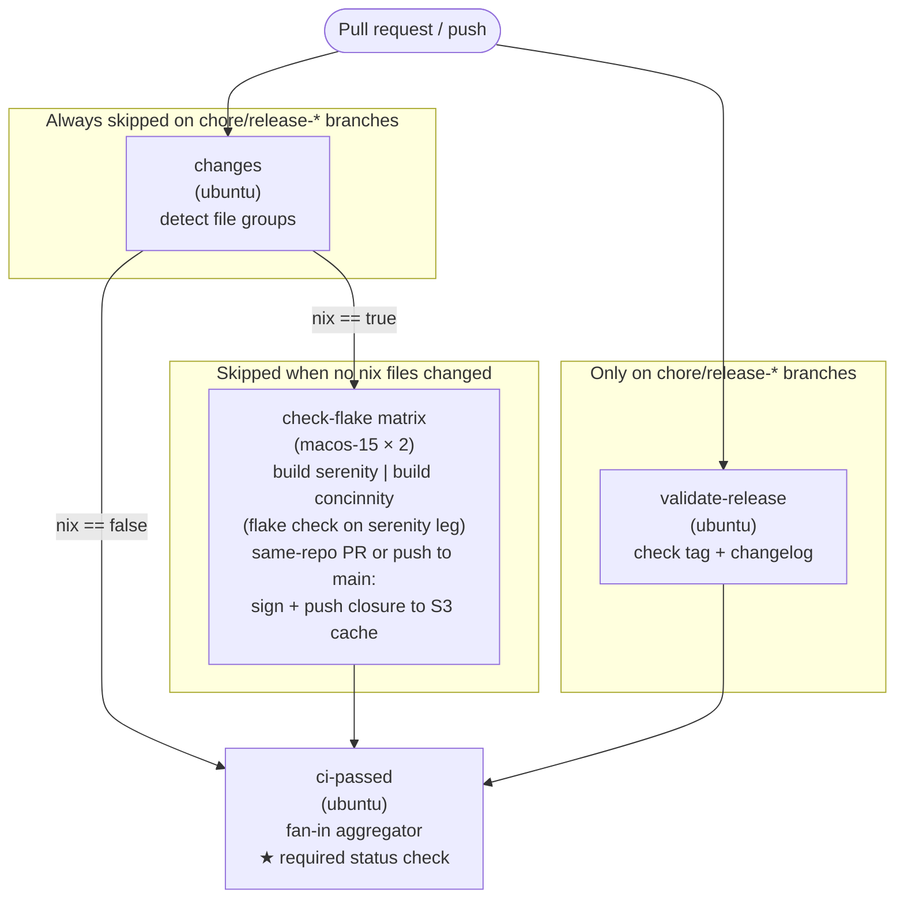

# CI job graph

`ci-passed` is the single required branch-protection status check. Skipped jobs count as passing, so a docs-only PR is never blocked waiting for `check-flake` to run.

The cache push runs in the same `check-flake` leg as the build, so each closure is built once. A failed cache step does not fail the leg (`continue-on-error`). Dependabot PRs get no repository secrets or OIDC role, so they only build and never push. A new push to a PR cancels the PR's running CI (`concurrency`); runs on `main` are not cancelled. Dependabot (`.github/dependabot.yml`) opens one grouped PR per week for action updates.

See [`.github/workflows/ci.yml`](../.github/workflows/ci.yml) for the full workflow definition.
